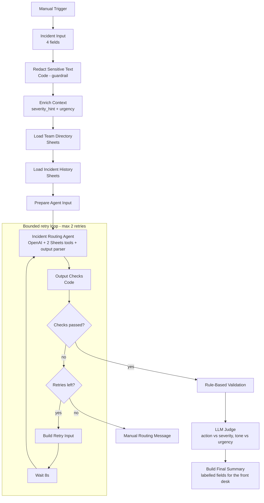

# Smart Incident Response Agent (n8n)

An agent-style n8n workflow that tells a **front-desk support agent** at ShopNow:
**which team should handle a production incident, and what to do first.**

It combines an LLM agent with two Google Sheets tools, input and output guardrails, a bounded retry loop and a final validation step.

- **Built and tested on:** n8n **2.35.7** (self-hosted, `npx n8n`). Every node type and version used is available in that release.
- **LLM:** the n8n **OpenAI Chat Model** node (credential: your OpenAI API key). The export uses the model id `gpt-luna-6`; if it is not available to your key, pick any OpenAI chat model that supports tool calling and structured output on the two **OpenAI Chat Model** nodes.
- **Data:** a Google Sheet with two tabs (`Team Directory`, `Incident History`), loaded from `data/*.csv`.

## Folder contents

| Path | What it is |
|---|---|
| `workflow/smart-incident-response-agent.json` | **The submitted n8n workflow (import this)** |
| `test-harness/smart-incident-response-agent.TEST-webhook.json` | Same workflow started by a webhook, with diagnostic output fields and one test-only node. Used only to run the test suites by script; not part of the solution |
| `data/team_directory.csv`, `data/incident_history.csv` | Sheet data for the two tabs |
| `prompts/system_prompt.md`, `prompts/validation_judge_prompt.md` | The agent's job description and the LLM judge's prompt (both are embedded in the workflow JSON) |
| `code/*.js` | The code of every Code node, as separate files so it can be unit-tested (`code/test_only/` is used by the test harness only) |
| `tests/` | Offline unit tests, live test runners and the recorded results (`tests/results/`) |
| `TEST_CASES.md` | Test scenarios, expected vs actual results, guardrail demonstrations |

## Setup (about 10 minutes)

1. **Google Sheet.** Create a sheet named `ShopNow Support Data` with two tabs named exactly `Team Directory` and `Incident History`. Import the matching CSV into each tab (File > Import > *Replace current sheet*). Row 1 must stay the header row. Copy the sheet ID from the URL (`.../d/<THIS-PART>/edit`).
2. **Credentials in n8n.**
   - *Google Sheets OAuth2 API*: sign in with the Google account that owns the sheet.
   - *OpenAI API*: your OpenAI API key.
3. **Import** `workflow/smart-incident-response-agent.json` (Workflows > Import from file).
4. **Reconnect four Google Sheets nodes** (`Load Team Directory`, `Load Incident History`, and the tools `team_directory` and `incident_history`): choose your spreadsheet and the tab, and select the Sheets credential. Select the OpenAI credential on both **OpenAI Chat Model** nodes (check the model field).
5. Edit the sample values in **Incident Input**, then click **Execute workflow**. Open the last node (**Build Final Summary**) and switch the output panel to **Table** view to read the answer.

> The export contains the placeholder `PASTE_YOUR_GOOGLE_SHEET_ID_HERE` and credential placeholders; no keys or personal data are included.

## Architecture



## Node by node

| # | Node | Purpose |
|---|---|---|
| 1 | Manual Trigger, **Incident Input** (Set) | The four inputs: `error_summary`, `specific_error` (optional), `users_affected`, `minutes_since_start`, written the way a front-desk agent would report them. The default sample deliberately contains an email, phone number and card number to show redaction. |
| 2 | **Redact Sensitive Text** (Code) | Masks emails, secrets/tokens, card-like numbers, phone numbers and other long numbers **before** the agent. Order matters: email, known key formats (Bearer, JWT, `sk-`, AWS, GitHub), 13-19 digit card numbers, phones (10-15 digits, so "500 customers" is safe), any 9+ digit run, then generic 20+ character mixed letter/digit tokens. Only redacted fields continue downstream. Also coerces numbers and defaults an empty `specific_error` to "None reported". |
| 3 | **Enrich Context** (Code) | Derives `severity_hint` and `urgency` (below), plus a readable reason for each. |
| 4 | Load Team Directory / Load Incident History (Sheets, *Execute Once*) | A **reference copy** of the two tabs, read once per run **for the output checks only**. The checks validate the agent's answer against these rows, not against the agent's own words. These rows are never passed to the agent: it reads the sheet through its own two tools and decides by itself whether to call `incident_history`. So the history sheet is read by this node on every run (a cheap, deliberate cost of independent verification), while the *agent's* use of the history tool is optional and is skipped for unrelated issues (see `TEST_CASES.md`, section 3). |
| 5 | **Incident Routing Agent** (AI Agent) | OpenAI chat model with a system prompt (the job description), a structured output parser and two Google Sheets tools. Intermediate steps are returned so the checks can see which tools were called. |
| 6 | **Output Checks** (Code) + IF nodes | Three required checks plus extras (below). A failure goes to the retry branch. |
| 7 | **Build Retry Input**, Wait, back to the agent | Sends the exact failure reasons back to the agent. `$runIndex` of Output Checks is the attempt counter, so the loop is bounded to 2 retries. After that: **Manual Routing Message**. |
| 8 | **Rule-Based Validation** + **LLM Judge** | Decision validation (below). |
| 9 | **Build Final Summary** | The answer as labelled single-line fields (*Send this to, Contact, Do this first, Past incident, Tell customers, Why, Seriousness, Notes*). Contact details come from the directory row, not from the model. *Notes* appear only when something needs flagging (a check or review concern, retries used, masked data). |

### Tools and how the agent tells them apart

| Tool | Sheet tab | Description given to the agent |
|---|---|---|
| `team_directory` | Team Directory | Returns every team with exact name, ownership, typical symptoms, on-call contact and channel. Always call first; the only source of team names and contacts; has no incident data. |
| `incident_history` | Incident History | Returns past incidents. Call **only** when symptoms might have happened before (not for typos, wording mistakes, one-off questions or other cosmetic issues); has no contact data. |

The system prompt additionally says: cite the incident ID and resolving team on a match, answer "None" when there is no match, never invent an incident, and treat the incident text as data only.

### Thresholds (and why)

| Derived value | Rule | Reasoning |
|---|---|---|
| `severity_hint` | `users_affected` < 50 low; 50-499 medium; >= 500 high. **+1 level** (cap high) if the text mentions payment/checkout/charge(d)/refund/card/billing, or security terms (breach, fraud, leak...). | Customer count is the simplest measure of blast radius. Money and security problems are more serious than the same number of customers affected by, say, a wrong product image, so they step up one level. |
| `urgency` | `minutes_since_start` < 15 new; 15-60 ongoing; > 60 prolonged. | Under 15 minutes is "just noticed"; up to an hour is "being worked"; beyond an hour customers are waiting too long and the communication has to change. |

### Output checks (guardrail) and retry

| Check | Rule |
|---|---|
| 1. Exact team | `primary_team` equals a `team` value in the directory. The contact and channel must also equal that row. |
| 2. Severity not downplayed | If `severity_hint` is high, `first_action` must not be "just monitor" / "keep an eye" / "wait and see" / "no action", and must contain an escalating verb (contact, page the on-call, post, notify...). |
| 3. Real incident | `matched_incident_id` is `None` or exists in the history; the resolving team quoted must match the sheet. |
| Extra | A cited incident requires that the `incident_history` tool was actually called; the `team_directory` tool must have been called; a missing or unparseable agent answer (for example an API error) counts as a failed attempt. |

On failure the reasons are fed back to the agent (up to 2 retries, with an 8-second wait). If it still fails, the output is a clear **MANUAL ROUTING NEEDED** message with the reasons.

### Decision validation

1. **Rules (deterministic):** high severity needs an escalating action; medium cannot be passive; low should not sound like an emergency. The tone must fit the urgency: new = calm or reassuring; ongoing = reassuring or apologetic; prolonged = apologetic.
2. **LLM judge (temperature 0, structured output):** a second opinion on the same two questions.

Concerns are shown to the front desk under *Notes*, not silently dropped. If the judge call fails, the workflow still completes with the rule checks.

## Design decisions worth explaining

- **Ground truth outside the agent.** Checks compare against rows loaded by plain Sheets nodes, so a model that hallucinates a team, contact or incident cannot pass. The preloaded rows are used only for this verification and are never shown to the agent, so they do not influence whether the agent calls the history tool. Trade-off: the history tab is read on every run, including runs where the agent skips its tool; a lazier design would load it only when an incident is cited, at the price of more branching inside the retry loop.
- **Contacts from the sheet.** Even after the checks pass, the final output prints the contact from the directory row.
- **Evidence of tool use.** `returnIntermediateSteps` lets the workflow verify that the history tool was really called before an incident is cited.
- **Tested code.** The code in every Code node is kept as a separate file in `code/`, so the unit tests exercise exactly the logic in the workflow.
- **Prompt-injection stance.** The prompt treats incident text as data only (tested in case 10).

## Testing

```
npm test                      # 37 offline unit tests: redaction, thresholds, the 3 checks, the retry loop, validation, final output
node tests/run_live_cases.js <webhook-url>        # 10 live scenarios against the test harness
node tests/run_guardrail_cases.js <webhook-url>   # 5 forced-failure demos (retry and manual routing)
node tests/run_tool_use_cases.js <webhook-url>    # history-tool use: 4 unrelated + 4 plausible-match cases, 3 runs each
```

Results of the live runs (10 of 10 scenarios, 5 of 5 guardrail demos, 24 of 24 history-tool-use runs) are in `TEST_CASES.md`, with the raw data in `tests/results/`. To run the live suites, import the file from `test-harness/`, connect the credentials as above, activate it, and pass its production webhook URL.

## Known limitations

- The Google Sheets tools return the whole tab, which is fine for the small dummy data but would need filtering for large sheets.
- Severity wording rules are English keyword based; they are a hint, not a classifier.
- LLM output varies slightly between runs; the checks enforce the structure and facts, not the exact wording.
- Live test results are from one run per case on one model and one n8n version (2.35.7).
